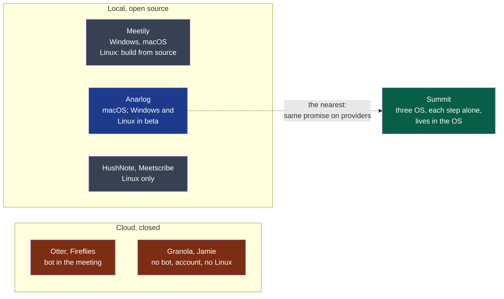

# Discovery

> Started by the engine's `discover` command, run by your agent (`playbooks/discovery.md`).
> One document, a decision at the end of each round.

## 1. Intake

*Confirmed by the decider on 2026-10-12, without correction.*

Summit is first for advanced users and small teams who want to keep control of their data
and of their costs — the professional who cares about confidentiality, the pragmatist who
mixes local and online, the tinkerer who uses one step only. They use it on their own
computer (Windows, macOS, Linux), during a meeting, online or in a room, or afterwards on an
audio file or a text. Their problem: note takers make them pick a side — a convenient but
closed cloud service (subscription, data held by a third party, an imposed AI model, a bot
in the meeting), or a respectful local tool limited to one platform or to one brick. Summit
is a discreet desktop application, living in the system tray and the file context menu, that
chains four independent steps — capture, transcribe, summarise, export — each with its own
provider (a local engine or an OpenAI-compatible service) and usable alone; local by
default, no bot, no account.

**Open questions:**

None left. The language of the project was decided at intake — English everywhere — and is
rule 1 of `docs/project/rules/always.md`.

## 2. Research

Run on 2026-10-12 with the agent runtime's web search and page fetch — the tooling profile
names no research tool yet. *Vendor* marks a figure a company reports about itself or its
market; *secondary* marks a claim not read at its primary source.

**Legend** — red: what the idea reacts against · grey: local tools that cover one platform
or one part · blue: the one product that already covers most of the idea · green: Summit.

| Claim | What it changes for the idea | Source |
|---|---|---|
| **Anarlog (ex-Hyprnote) is MIT, needs no account on its free plan, lets the user pick the transcription engine and the summary model separately — local, own keys, Ollama, LM Studio — and ships Windows and Linux builds in beta** | The idea's central claim — *no product combines Linux, per-step configuration and OS integration* — now rests on the third point alone, and on Linux being first-class rather than beta. This is the finding that most changes the decision | [anarlog.so/about](https://anarlog.so/about/), read 2026-10-12 |
| Meetily is MIT, Windows and macOS; on Linux "build the app bundle from source", a native app "in development". Transcription is local only; cloud summary keys are a Pro feature | Confirms the Linux gap for this one; shows a competitor charging for what Summit gives away — bringing one's own key | [meetily.ai](https://meetily.ai/open-source-ai-note-taker), read 2026-10-12 |
| OpenWhispr runs on macOS, Windows and 64-bit Linux, detects Zoom and Teams calls, transcribes with speaker labels, local or own keys including OpenRouter. Its page does not mention meeting summaries | A second cross-platform product with Linux — a dictation tool growing toward meetings | [docs.openwhispr.com](https://docs.openwhispr.com/), read 2026-10-12 |
| Linux-only local tools exist: HushNote and Meetscribe capture microphone and system audio separately through PipeWire or PulseAudio, transcribe with Whisper, summarise with Ollama | Capturing "me" and "others" as two sources on Linux is done, by small projects: feasible, not novel | [HushNote](https://github.com/peteonrails/hushnote), [Meetscribe](https://www.sourcepulse.org/projects/26636893) — *secondary*, repositories not read |
| Prices of the field: Granola Business $14 per user per month; Jamie €25 and €47 per month; Anarlog Pro $14 per person per month; Meetily Pro $10 per user per month billed annually; MacWhisper Pro about €59 once | Three models: subscription, open core with a hosted paid tier, one-time licence. Summit's "charges nothing" matches none of them | Anarlog and Meetily: their pages above. Granola, Jamie, MacWhisper: *secondary* ([Granola](https://www.usecarly.com/blog/granola-pricing/), [Jamie](https://toolradar.com/tools/jamie/pricing), [MacWhisper](https://www.getvoibe.com/resources/macwhisper-pricing/)) |
| 75% of professionals use an AI note taker in work meetings; 73% of businesses name privacy as the first barrier | If true, the alternative to Summit is rarely "nothing" — it is a tool already installed; and the privacy argument has an audience | *Vendor*: a Fellow.ai survey, repeated by [Laxis](https://laxis.com/blog/state-of-meeting-note-taking-2026). Neither survey was read |
| The share of people who still take notes by hand | — | **Not found** |
| France, Penal Code art. 226-1: recording private or confidential words without consent — up to one year and €45,000; consent is presumed when the recording is made openly and the person could object | C6 and C7 of the idea — always visible, always reminding — are what makes the recording lawful, not a courtesy. "Record automatically" as a default is the risky setting | *Secondary*, publishers' blogs ([Noota](https://www.noota.io/fr/blog/enregistrer-reunion-sans-consentement), [Notta](https://www.notta.ai/fr/blog/rgpd-enregistrement-reunion)); the article itself and the CNIL's guidance were not read |
| United States: *Brewer v. Otter.ai*, N.D. Cal., no. 5:25-cv-06911, filed 15 August 2025 — a participant recorded by another participant's bot, without being asked; more than $5 million sought, consolidated with three other suits | The liability falls on the vendor who records by default. Summit records nothing on its own servers, which moves the question to its user — and to its defaults | [NPR](https://www.npr.org/2025/08/15/g-s1-83087/otter-ai-transcription-class-action-lawsuit), [Fisher Phillips](https://www.fisherphillips.com/en/news-insights/new-lawsuit-highlights-concerns-about-ai-notetakers.html) — *secondary* for the docket |

**Assumptions** — what could not be sourced:

- That users of a local tool accept "a slightly worse result", as the idea's first profile says.
- That a non-technical person can use Summit "once configured" by someone else.
- That living in the tray and the context menu, rather than in a window, is something users
  want — no product of the table does it, which proves a gap, not a demand.
- That Anarlog's Linux beta is not usable today: nobody tried it here.

**Open questions:**

1. With Anarlog covering most of the promise, what is Summit's reason to exist that a user
   would name — and is it enough to build a product rather than contribute to that one?
2. Who pays for Summit's development, since it charges nothing and selling is out of scope?
3. Which countries' recording law must the defaults satisfy?

## 3. Define

**Users and their problem:** <quoted from users: who, how many>

**Constraints:** <who runs it, budget, platforms, regulation>

**Success signals:** <what will be observed, and by when, if the idea is right>

**Open questions:**

## 4. Shape

**Value hypothesis:** <why a user would switch — stated so that it can be proven wrong>

**Press release:** <launch day, or a placeholder: the user, the problem, the product, one quote labelled as imagined>

**Convinces the decider?** <their answer, or an open question>

**No-gos:** <the decider's; the framer's, marked proposed>

**Open questions:**

## 5. Challenge

**Challenger:** <@human, or the agent session> · <date>

**Pre-mortem:** <the reasons, each tagged with its risk>

**The four risks:**

| Risk | Riskiest assumption | Cheapest test — and the result that refutes it |
|---|---|---|
| Value | | |
| Usability | | |
| Feasibility | | |
| Viability | | |

**Counter-evidence:**

**Flaws in stages 1 to 4:** <each citing its line>

## 6. Decision

<go · clarify · kill; the reasons; for a go, why each objection does not block it, and what
the first cycle carries: spikes, no-gos.>
