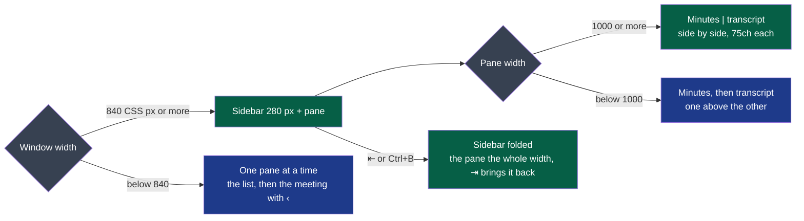

# D61 — the window in two panes, drawn before it is built

**Drawn** 2026-10-29, first round · **Status**: drawn by D61's author, for the decider to read by 2026-10-30 ([cycle 04, D61](../../cycles/04-wholeheard-on-macos.md#d61), its dependency with a date) · **Frozen**: these drawings are not kept up to date. What the decider accepts becomes the criteria of the deliverable that builds it; once built, the window and its screenshots are the truth. A new round is a new folder.

It replaces D11's boards 1, 2 and 4 for their layout ([d11-the-window](../d11-the-window/README.md)); those stay the record of what was accepted then.
The words are proposals, in French; the yellow notes are the author's proposals for the decider.

**Legend** — grey: the width that decides · green: the two panes · blue: one column.

| # | Board | What the user sees, and can do |
|---|---|---|
| 1 | [Full screen, 1920 × 1080](1-two-panes-light.png) · [dark](1-two-panes-dark.png) | The sidebar: *Démarrer un enregistrement* and its shortcut, the search, the meetings by week — title, length, what each holds —, at its foot the space taken with *Faire de la place*, then *Réglages*. The meeting chosen marked, `aria-current`; beside it, the pane the whole width left, minutes and transcript side by side. The header's tabs and *‹ Réunions* gone |
| 2 | same image | The sidebar folded by ⇤ or Ctrl+B (⌘B): the pane the whole width, ⇥ brings it back; kept by the settings |
| 3 | same image | A 1100 px window: the pane under 1000 px, the minutes above the transcript. Settings in the pane, 720 px at most, *Réglages* marked in the sidebar |
| 4 | same image | Below 840 px, down to 420 × 400: the list alone, then the meeting with ‹ to go back, *Ouvrir le dossier* under ⋯ |
| 5 | same image | No meeting yet: the pane says what to do and offers the recording |

Sources for the layout, read 2026-10-29, as the cycle cites them: Material 3's [canonical layouts](https://developer.android.com/develop/adaptive-apps/guides/canonical-layouts) (list and detail side by side at 840 dp and more), [libadwaita's adaptive layouts](https://gnome.pages.gitlab.gnome.org/libadwaita/doc/1.8/adaptive-layouts.html) (a sidebar of 25 % between 180 and 280 sp), Apple's [sidebars](https://developer.apple.com/design/human-interface-guidelines/sidebars.md) (one the user can hide).

[`board.html`](board.html) is the board's source, with `ui/window.css`'s colours; the images are
rendered from it at 1280 px wide (`chromium-browser --headless --screenshot`, `?dark` for the dark
theme). The windows are drawn at their size, then scaled: the scale is in each section's title.
