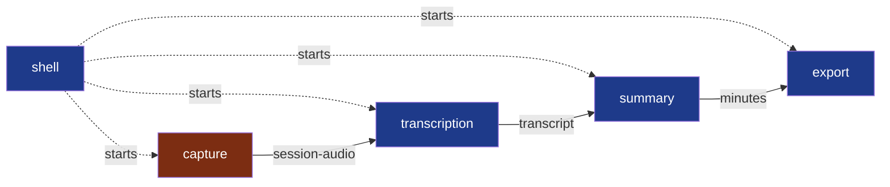

# Modules

**Legend** — one module per step of Summit, and `shell`, which starts them and holds none
(dotted) · red: holds other people's voices, `critical` before the repository is opened ·
arrows: the contracts between the steps, each a file of the session — `session-audio`,
`transcript` and `minutes` are written, version 1.

| Module | Today |
|---|---|
| `capture` | A program that records two files; tried on Fedora |
| `transcription` | A program that writes the transcript with Whisper on the machine; tried on Fedora |
| `summary` | A program that writes the minutes with the provider the user chose |
| `export` | Described, no code yet |
| `shell` | Described, no code yet |

Why four, and what each one is for: [`docs/adr/0001`](../docs/adr/0001-split-summit-into-four-modules.md). Why a fifth that holds no step: [`docs/adr/0002`](../docs/adr/0002-a-rust-core-of-programs-and-a-web-view-shell.md).

Brought current by the pull request that creates, merges or retires a module.

What a module is, when to split one and what its folder holds:
[`.nstack/handbook/02-modules.md`](../.nstack/handbook/02-modules.md). Creating one:
[`.nstack/handbook/INSTALL.md`](../.nstack/handbook/INSTALL.md).
