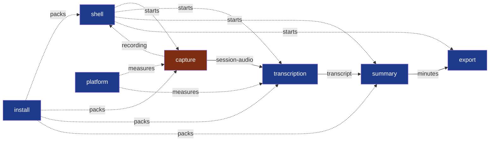

# Modules

**Legend** — one module per step of Wholeheard; `shell`, which starts them and holds none,
`platform`, the bench that measures them, and `install`, which packs their programs (dotted) ·
red: holds other people's voices, `critical` before the first build published for people
outside the project ([PDR-0002](../docs/pdr/0002-the-repository-opened-the-pace-kept.md)) ·
arrows: the contracts between the steps, each a file of the session — `session-audio`
(version 2, what `capture` writes; version 1 still read), `transcript` and `minutes`, version 1 — and
`recording`, version 1: what `capture` says to the shell while it records.

| Module | Today |
|---|---|
| `capture` | A program that records each source as delivered, with the session's clock; tried on Fedora |
| `transcription` | A program that writes the transcript with Whisper on the machine, each segment on its track and its time, the loudspeakers' echo taken out; reads both forms of a session; tried on Fedora |
| `summary` | A program that writes the minutes with the provider the user chose |
| `export` | Described, no code yet |
| `shell` | Wholeheard, started with the user's session: the small window to record, a call offered to be recorded; the window — the meetings and what they weigh, one's minutes beside its transcript, played with its words following, space freed and undone, the settings and the models fetched on the user's word |
| `install` | The package a user installs, every program beside the shell: an rpm for Fedora, a `.deb` for Ubuntu, each built in a container of its system |
| `platform` | Not a step: the bench that measures the steps against a meeting whose every word is known, and real meetings with a human transcript |

Why four, and what each one is for: [`docs/adr/0001`](../docs/adr/0001-split-summit-into-four-modules.md). Why a fifth that holds no step: [`docs/adr/0002`](../docs/adr/0002-a-rust-core-of-programs-and-a-web-view-shell.md). Why one that packs them: [`docs/adr/0006`](../docs/adr/0006-a-module-assembles-the-package-from-each-modules-release.md).

Brought current by the pull request that creates, merges or retires a module.

What a module is, when to split one and what its folder holds:
[`.nstack/handbook/02-modules.md`](../.nstack/handbook/02-modules.md). Creating one:
[`.nstack/handbook/INSTALL.md`](../.nstack/handbook/INSTALL.md).
