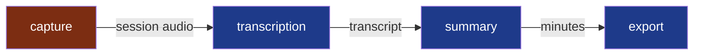

# Modules

**Legend** — one module per step of Summit · red: holds other people's voices, `critical`
before the repository is opened · arrows: the contracts between them, each a file of the
session; **none is written yet**, they come with the first cycle's deliverables.

Why four, and what each one is for: [`docs/adr/0001`](../docs/adr/0001-split-summit-into-four-modules.md).

Brought current by the pull request that creates, merges or retires a module.

What a module is, when to split one and what its folder holds:
[`.nstack/handbook/02-modules.md`](../.nstack/handbook/02-modules.md). Creating one:
[`.nstack/handbook/INSTALL.md`](../.nstack/handbook/INSTALL.md).
