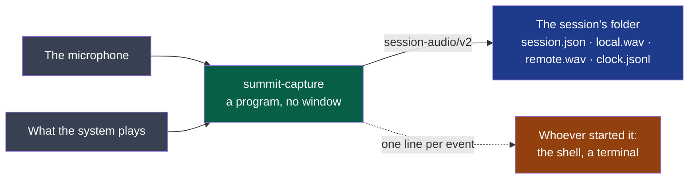

# capture

Records the audio sources of a conversation into a session.

- **Owner**: NapkinStack/maintainers
- **Criticality**: standard
- **Manifest**: [MANIFEST.yaml](./MANIFEST.yaml)



**Legend** — grey: the two sources · green: this module · blue: what it provides, the
contract · orange: who reads its events. It consumes no contract.

## Getting started

```bash
nstack bootstrap capture     # the toolchain's components and, on Linux, the sound headers
nstack check capture         # format and lint
nstack test capture          # no audio device needed, nobody recorded
nstack run capture           # lists the devices the system offers
nstack e2e capture           # records two notes on devices made for the run: nobody is recorded
```

Recording — **the people recorded know it**:

```bash
cargo run --release -- record <sessions-folder>   # until Ctrl-C, a TERM signal, or "stop" on its input
cargo run --release -- record <sessions-folder> --as v1   # the same, in the first form
```

**`nstack e2e capture`** runs D3's scenarios without a call and without a voice: for about a
minute the system's default output and input are two silent devices of its own, a note is
played into each, and the program records them — stopped as a user stops it, read while it
writes, left silent, killed, and with the same sound in both sources to see that the two files
keep one clock. It runs nothing where there is no sound server, or while an
application holds a microphone; what it saw is in `.evidence/e2e.txt`. A real call, a real
microphone and a headset stay a person's to try; so do a source that rests away from zero and
one that stops delivering, which silent devices cannot play and the module's tests hold.

## What it says while it runs

One JSON object per line on its output; errors go to the error stream.

| `event` | When | Carries |
|---|---|---|
| `started` | The two files exist and grow | `folder`, `sources` |
| `unavailable` | A source could not be opened, the other is recorded: it has no file at all — with `--as v1`, it is written as silence | `source`, `reason` |
| `silent` | A source has given no sound for ten seconds | `source` |
| `heard` | A source told silent gives sound again | `source` |
| `stopped` | The files are finished and `session.json` says so | `folder`, `seconds` |

A source is named for the device the system's default stands for when the recording starts — read from PipeWire's metadata — so that a microphone other than the call's shows at once; `summit-capture devices` prints it as `stands_for`. Unread, the default's own name.

These lines are a contract: [`recording/v1`](../../contracts/recording/v1/README.md), which the shell reads. They are the same lines in both forms, and still name the sources `me` and `others` where the second form's files are `local` and `remote`.

## Contracts

- Provided: [`session-audio/v2`](../../contracts/session-audio/v2/README.md), `experimental`
  — each source as delivered, with the session's clock: what `record` writes, and so what the
  tray records (ADR-0004)
- Provided: [`session-audio/v1`](../../contracts/session-audio/v1/README.md), `experimental`
  — the first form, two files at 16 kHz: what `record … --as v1` writes, to compare with it
- Provided: [`recording/v1`](../../contracts/recording/v1/README.md), `experimental`
  — what `record` says while it records
- Consumed: none

## Decisions

[ADR-0002](../../docs/adr/0002-a-rust-core-of-programs-and-a-web-view-shell.md): a program
of its own, in Rust, on one audio library.
