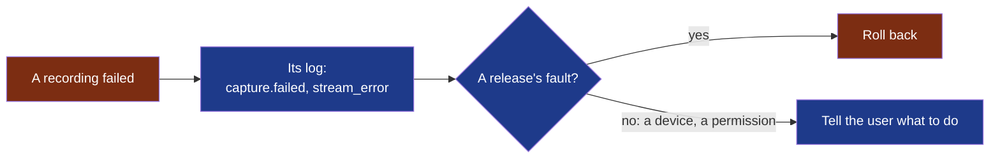

# capture — runbook

What to do when a recording fails, and who owes what now that capture is `critical`
(PDR-0002, decision 2; D55).



**Legend** — red: what costs a meeting · blue: what to do.

## Find a recording that failed

Logs are one JSON line per event, never a word of a meeting:

| System | Where |
|---|---|
| Linux | `$XDG_STATE_HOME/wholeheard/logs/capture.<date>.jsonl` (`~/.local/state/…` by default) |
| Windows | `%LOCALAPPDATA%\Wholeheard\logs\` |
| macOS | `~/Library/Logs/Wholeheard/` |

```bash
grep -E '"capture\.(failed|stream_error|unavailable|zeros|not_followed)"' ~/.local/state/wholeheard/logs/capture.*.jsonl
```

| Message | Means | Level |
|---|---|---|
| `capture.failed` | The recording ended on an error; `detail` says which | error |
| `capture.stream_error` | A source's stream reported an error; `source` names it | warning |
| `capture.unavailable` | A source could not be opened: the other is still recorded | warning |
| `capture.zeros` | A track holds exact zeros at `at` seconds: a device sent nothing | warning |
| `capture.silent` | A source stayed silent; `nothing` true: it sends nothing at all | info |

A session left without its end (`stopped` absent in `session.json`) was cut: the machine went off,
or the program was killed. What was written up to then is kept.

## What a user is told

The shell says it, in the user's language (`modules/shell/src/words.rs`): a notification when the
recording cannot start or ends on an error; a sentence when a side stays silent, with what to do;
*Interrupted* on a meeting never stopped. A user asked for a report sends the lines above: they hold
no word of a meeting.

## Roll a release back

| Where | How | Tried |
|---|---|---|
| Fedora | `sudo dnf downgrade ./wholeheard-<previous>.rpm`, the previous package kept beside the release | 2026-10-30, by the framer, on a Fedora 44 container: 0.2.0-2 back to 0.2.0-1, a meeting's folder untouched, the four programs there. A rebuilt package stood in for the later release |
| Ubuntu | `sudo apt install --allow-downgrades ./wholeheard_<previous>_amd64.deb` | Not tried |
| The Microsoft Store | It takes no lower version: the previous code is submitted again under a higher one | Not tried: nothing is submitted yet |

Meetings are the user's files: no rollback touches them. A session's contract version a previous
release cannot read is the one thing to check first: read `contracts/session-audio` against it.

## Who does what, and when

| Row of `.nstack/handbook/05-workflow.md` §7 | Who | When |
|---|---|---|
| Every scenario re-run at the head | The verifier, automated rows by `nstack attest` | Every pull request of this module |
| E2E on critical journeys | `scripts/` e2e, on virtual devices, through `nstack attest` | Every pull request of this module |
| Rollback verified | The framer | Before each published release; the table above dated |
| UAT | The decider, a real call | Before a build is published outside the project |
| After a release verified | The decider, the published build recording a real call | Once it is published |
