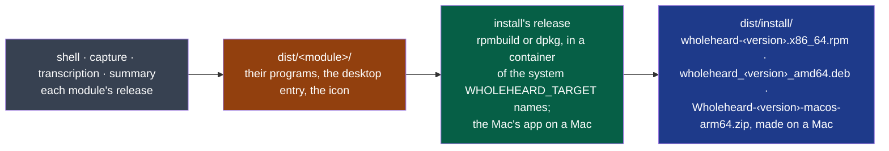

# install

What this module is for, who owns it and how critical it is: its
[MANIFEST.yaml](./MANIFEST.yaml), the one place they are written.



**Legend** — grey: the modules whose programs it packs · amber: their release artefacts ·
green: this module · blue: what a user installs. It provides and consumes no contract; why it
exists: ADR-0006.

## Getting started

Needs `podman`. From the repository's root:

```bash
nstack release                                    # for this Fedora: every module, then the rpm
sudo dnf install ./dist/install/wholeheard-*.x86_64.rpm

WHOLEHEARD_TARGET=ubuntu-24.04 nstack release         # each program built in an Ubuntu container, then the .deb
sudo apt install ./dist/install/wholeheard_*_amd64.deb
```

`WHOLEHEARD_TARGET` names the system the package is for — `fedora-44`, `ubuntu-24.04` — for every
module at once: each program is built in a container of that system, so that it links what that
system has (D27).

On a Mac, `nstack release` makes `dist/install/Wholeheard-<version>-macos-arm64.zip`: the app,
its four programs in `Contents/MacOS` and transcription's `wholeheard-speech` (D42), signed ad hoc, not by Apple. GitHub's macOS runner makes
it on every change to a program on `main` (`.github/workflows/macos-app.yml`, the job *the app*; on a pull request only when it changes install) and keeps it 7
days on the run. Opened the first time through System Settings → Privacy & Security → Open
Anyway (D38).
