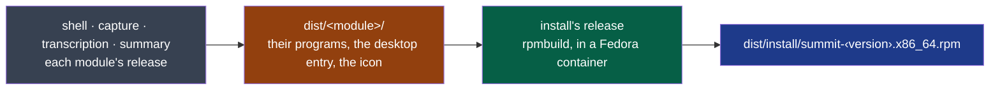

# install

What this module is for, who owns it and how critical it is: its
[MANIFEST.yaml](./MANIFEST.yaml), the one place they are written.



**Legend** — grey: the modules whose programs it packs · amber: their release artefacts ·
green: this module · blue: what a user installs. It provides and consumes no contract; why it
exists: ADR-0006.

## Getting started

Needs `podman`. From the repository's root:

```bash
nstack release                     # every module, each after what it assembles
sudo dnf install ./dist/install/summit-*.x86_64.rpm
```
