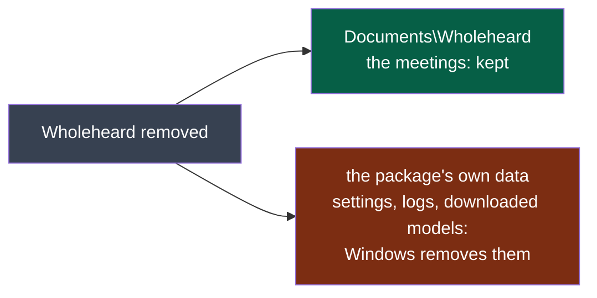

# Wholeheard — notes for certification

To paste in Partner Center's *Submission options → Notes for certification*, and to read before the
first submission (D54; [PDR-0004](../../../docs/pdr/0004-windows-through-the-microsoft-store.md)).

## Why it declares what it declares

| Capability | Why |
|---|---|
| `runFullTrust` | Wholeheard records both sides of a call: the user's microphone and the sound the system plays, by loopback, in `wholeheard-capture.exe`. The shell starts that program and the two that transcribe and summarise as child processes, beside it in the package. Four desktop programs at medium integrity, not one in an AppContainer. |
| `microphone` | The user's side of the call. Windows' privacy settings can turn it off. |

A recording starts only on the user's gesture, and by default Wholeheard reminds them to tell the participants.
Audio stays on the machine unless the user names a provider of their own.

## What removing it keeps

**Legend** — grey: the gesture · green: what stays · red: what goes.

The meetings are in the user's Documents, which a packaged application writes as any other and which
Windows leaves. Settings and models are written under `AppData`, which Windows redirects to a place
per user and per package and removes with it
([Microsoft, *Understanding how packaged desktop apps run*](https://learn.microsoft.com/en-us/windows/msix/desktop/desktop-to-uwp-behind-the-scenes),
read 2026-10-30). `windows/trial.ps1` holds both on GitHub's Windows runner, at every run of
`.github/workflows/windows-app.yml`.

## What stands between the package and a submission

The Windows App Certification Kit, run on the package at every run of `windows-app.yml` (D77; its
report kept beside the package, `appcert-report.xml`), said on 2026-10-31, kit 10.0.26100.9457,
Wholeheard 0.2.0: **PASS overall, 24 tests, 1 failed**.

| Test | Kit's verdict | Why | What it asks |
|---|---|---|---|
| Blocked executables (88) | FAIL, optional | The shell starts the three other programs (`CreateProcessW`, `ShellExecuteW`), and the programs name `cmd`, `reg`, `powershell` in their code | Nothing yet: launching processes is what `runFullTrust` is declared for, above. Whether Partner Center's own review accepts it is known at the first submission only |

Before that submission:

- `identity.json` still holds a placeholder: fill it with the *Package/Identity* values from
  Partner Center's *View app identity details*, and set `placeholder` to `false`.
- The application's version must reach 1: the Store refuses a first part 0
  ([*App package requirements*](https://learn.microsoft.com/en-us/windows/apps/publish/publish-your-app/msix/app-package-requirements),
  read 2026-10-30).
- The Store re-signs the package; the run's certificate is for the run and for a colleague's trial
  only.
- Not yet seen: a call recorded from inside the package (D54's fourth criterion, a colleague's).
