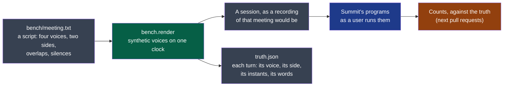

# platform

Measures what Summit's steps produce against a meeting whose every word is known.

- **Owner**: NapkinStack/maintainers
- **Criticality**: standard
- **Manifest**: [MANIFEST.yaml](./MANIFEST.yaml)



**Legend** — grey: files · green: this module · blue: the steps it measures, never its own
code · orange: what comes next.

**The bench** (cycle 02, D8; ADR-0004) is the oracle of every change to how a meeting's audio
is captured or derived. Its meeting is a script written for the purpose, in French because
that is what the product hears, said by four public synthetic voices: **nobody is recorded**.
Two sides, as a session has two tracks; two people on the local side, behind one microphone.

**Three listening conditions**, the same meeting each time — and for each, several draws of
the microphone's noise, so that a count is read as a spread:

| Condition | The microphone holds | Set on |
|---|---|---|
| `headset` | The local voices and a quiet microphone's noise; nothing of the remote ones | Supposed: no headset was measured |
| `low` | The same voices, a laptop microphone's noise, and the remote side 46 ms late, 10 dB under what was played, four fifths of it at once and the rest ringing | The decider's laptop at a usual meeting's volume, 2026-10-13 |
| `loud` | The same, 5 dB under, from loudspeakers pushed until they no longer play what they are sent | The same laptop, near its maximum |

The room is a model set on one minute of one laptop in one room. It says how one way of
doing compares with another; it does not promise what a real room gives.

**The counts** read transcripts against the truth, each with what it is counted out of:

| Count | Says |
|---|---|
| Words wrong, on each side — and those of turns not found | What the transcript gives a side against what it said; a turn dropped whole is said apart from a word misheard |
| Words wrong net of the echo, local | The local side's own words wrong, without the remote's it was given: **what a canceller is read on** — muting removes the echo's words and cannot lower this |
| Local words lost under the remote | What the local side said while the remote spoke, or in the third of a second after, and the transcript lacks: **what muting the microphone to kill an echo costs** |
| Words said twice | The remote side's words given to the local side too: the echo |
| Words on the wrong side | A side's words given only to the other |
| Exchanges out of order | Where the meeting passes from one side to the other, and the transcript puts the two turns the other way round than they were said |
| Turns far from their time | Turns the transcript starts more than two seconds from where they were said |

No count is read alone: an echo killed by muting the microphone is perfect on *said twice*
and pays on *lost under the remote*. A turn is where the transcript puts its first words;
order and time are read as a share of the turns found, with those not found beside. A
transcript that is not one whole `transcript/v1` of that meeting is refused, not counted.

```bash
# Each draw of a condition is transcribed by the program under test, then counted together.
summit-transcription <out-folder>/low/0 --model <model-file> --language fr   # and /1 to /5
uv run python -m bench.counts <out-folder>/low/0 <out-folder>/low/1 <out-folder>/low/2   # … /5
```

```bash
# Once: the voices, about 330 MB, from the synthesiser's public models.
uv run python -m piper.download_voices fr_FR-siwis-medium fr_FR-tom-medium fr_FR-upmc-medium fr_FR-gilles-low --download-dir <voices-folder>
# The meeting under three conditions, six draws each: <out-folder>/<condition>/<draw>.
nstack run platform <voices-folder> <out-folder>
```

A synthetic voice is easier to transcribe than a person's: the bench says how one way of
doing compares with another on the same meeting, not how well Summit hears a real one.

## Getting started

The standard verbs — `bootstrap`, `check`, `test`, `run` — are declared in the `commands`
section of the [manifest](./MANIFEST.yaml), for this module's stack. What each one must do:
`.nstack/handbook/09-platform.md` §2.

## Contracts

- Provided: none
- Consumed: [`session-audio/v1`](../../contracts/session-audio/v1/README.md) — it writes a session as that contract describes one, for the programs to read
- Consumed: [`transcript/v1`](../../contracts/transcript/v1/README.md) — it reads the transcript the programs wrote of it

## Decisions

See `docs/adr/`.
