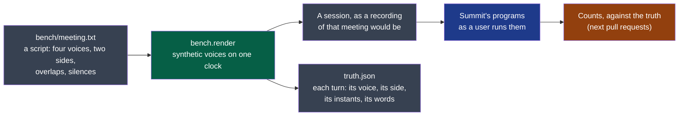

# platform

Measures what Summit's steps produce against a meeting whose every word is known.

- **Owner**: NapkinStack/maintainers
- **Criticality**: standard
- **Manifest**: [MANIFEST.yaml](./MANIFEST.yaml)

**Legend** — grey: files · green: this module · blue: the steps it measures, never its own
code · orange: what comes next.

**The bench** (cycle 02, D8; ADR-0004) is the oracle of every change to how a meeting's audio
is captured or derived. Its meeting is a script written for the purpose, in French because
that is what the product hears, said by four public synthetic voices: **nobody is recorded**.
Two sides, as a session has two tracks; two people on the local side, behind one microphone.

**Today** the module is described and holds no code: its meeting and its renderer come in the next pull request.

A synthetic voice is easier to transcribe than a person's: the bench says how one way of
doing compares with another on the same meeting, not how well Summit hears a real one.

## Getting started

The standard verbs — `bootstrap`, `check`, `test`, `run` — are declared in the `commands`
section of the [manifest](./MANIFEST.yaml), for this module's stack. What each one must do:
`.nstack/handbook/09-platform.md` §2.

## Contracts

- Provided: none
- Consumed: none yet

## Decisions

See `docs/adr/`.
