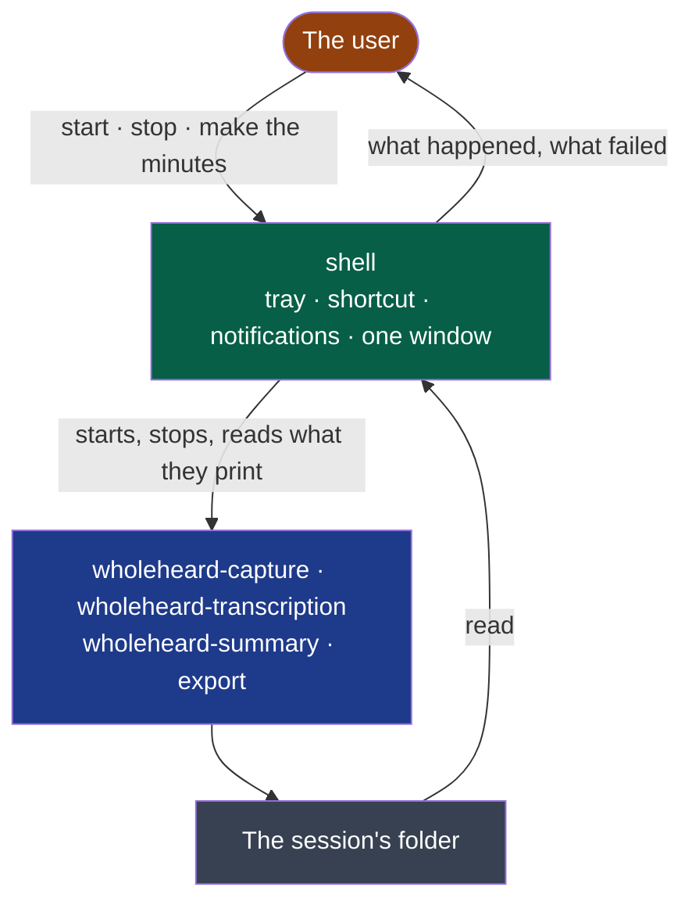
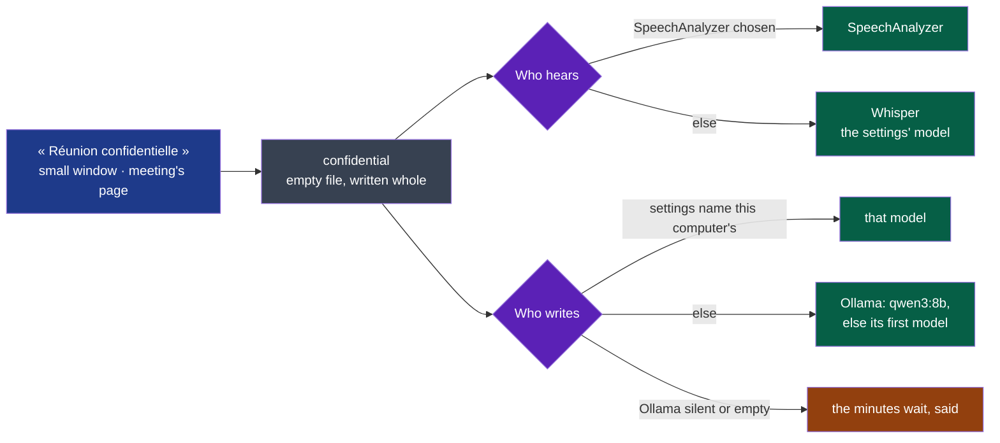

# shell

Puts Wholeheard's four steps in the user's hands: a tray, a global shortcut, notifications, one window.

- **Owner**: NapkinStack/maintainers
- **Criticality**: standard
- **Manifest**: [MANIFEST.yaml](./MANIFEST.yaml)



**Legend** — orange: whoever uses Wholeheard · green: this module · blue: the four steps, programs
it starts and never reads the code of · grey: files, the only thing it shares with them.

**It holds no step** (ADR-0002): closed or crashed, a recording goes on, and every step still
runs from a terminal.

**Today**: an icon in the tray whose menu starts and stops a recording, the same from a
global shortcut — Super+Alt+M under a Linux desktop — and a notification for what matters:
the reminder to announce the recording, with the microphone recorded named in it — one
other than the call's shows at once — a source that is silent, a device switched while it
records, named, or none left for a side (D31), the stop, a failure. In
French where the system is, in English anywhere else.

**A call offered** (D30, Linux): when another application takes a microphone — a call in
Discord, a browser tab —, a notification names it and offers *Record*, *Not this time* and
*Never offer*: once while it holds one, never while recording. The shell watches PipeWire's graph
with `pw-dump --monitor`; what it sees is shown in the notification and kept nowhere.
`offer = false` in the settings file turns the offers off.

**Started with the session** (D32, Linux), so that a call is offered after a restart: at its
first start, Wholeheard writes `~/.config/autostart/dev.wholeheard.Wholeheard.desktop`
([XDG Autostart](https://specifications.freedesktop.org/autostart-spec/latest/)) — the tray
alone, no window; `TryExec`, so a removed package starts nothing. The entry is the setting:
Settings' *Lancer Wholeheard à l'ouverture de session* writes or removes it, and reads it as the
desktop's tools leave it (`Hidden`, `X-GNOME-Autostart-enabled`). `autostart` in the settings
file says Wholeheard wrote it once: turned off, it is never written again by itself.

**One Wholeheard** per session (D35): a second start hands its arguments to the running one and
leaves ([tauri-plugin-single-instance](https://v2.tauri.app/plugin/single-instance/)). The
applications' menu runs `wholeheard --window`, so its window opens, running or not; started again
with the session, nothing opens.

**The window** (cycle 03, from D11's drawings) is opened by *Open Wholeheard* in the menu — or at
once by `wholeheard --window` — and never without a gesture: the meetings in the sessions'
folder by week, newest first, each with its day, its length, what it holds and what its
audio weighs, and above them what all the audio weighs against the transcripts and minutes.
A session being recorded, or one left without its end, says so. It reads `session.json` of
both forms (`contracts/session-audio`) and writes nothing; it speaks the system's language,
follows its light or dark theme and font, in the colours of D11's boards, and reads the
folder again whenever it comes forward. In two panes since D61 (its board,
[`d61-the-window-in-two-panes`](../../docs/project/drawings/d61-the-window-in-two-panes/README.md)): the
meetings in a sidebar of 280 px with the recording, a search over what each row says, the weights and
*Réglages*; the meeting chosen — the last one at first, ↑ and ↓ on the list for the others — and Settings,
freeing space and the agreements in the pane beside it, as wide as the window leaves it; under 840 px,
one at a time, the pane with a way back. A meeting opens from the list: its minutes as written, with
who wrote them and where; its transcript in the meeting's order, each line with its side and
voice, searched over what was said — the two side by side once the pane is 1000 px wide, their text
75 characters at most; who spoke over the meeting; its folder, opened in the
system's file manager. *Réglages* sets what follows a recording, the transcription's model among
those on this computer, the reminder and how long the audio is kept — each choice saved at once
in the settings file; one Wholeheard could not read is said, and not written over. Audio kept
longer than the settings say goes to the system's trash — at start, then every hour, said once —
from sessions whose transcript is whole; their transcript and minutes stay.

**The small window** (D35, D34's board) opens first: *Démarrer un enregistrement* and the shortcut
as the desktop granted it — or where to choose one —, the last meeting and where it stands, what
the meetings weigh, and the way to the full window. A recording shows in it (board 6, D33), above
the other windows until the stop; then it comes back to rest. One window at a time: going from one
to the other replaces it, and the one left — `window` in the settings, `small` or `full` — is the
one reopened. A settings file that cannot be read opens the full window, where it is said.

**The first start** (D58, [its board](../../docs/project/drawings/d58-the-first-run/)) opens the
full window on a short assistant, once — with `--window` or not, started with the session too: one
question, are the meetings confidential; a second, who writes the minutes, only for « Rarement ou
jamais »; then the setting said plainly, the model fetched on a click. *Passer*, « Je ne sais pas »
and no answer keep everything on this computer. It opens by itself only while `welcomed` in the
settings is not true and the sessions' folder holds no meeting, and `welcomed = true` is written as
soon as it shows; *Settings → Refaire le réglage* opens it again, nothing changed before its last
screen. The window left (`window`) is not changed by it.

**A meeting's context** (D59, [its board](../../docs/project/drawings/d59-the-context/)) — what it
is about, who takes part — is written in the window: while recording, the small window's *Ajouter
le contexte*, closed by default, and the meeting's page, the one being recorded too. It is kept as
it is typed as the meeting's `context.txt` (`contracts/session-audio/v2`), written whole through a
file beside it and only once the folder holds `session.json`; 400 characters at most, counted as
characters; another script than Latin or Cyrillic is said, Whisper keeping only the last 224
tokens. The transcript and the minutes read it as they start: the field is closed while either is
made, or a transcript is left unfinished. Changed after they were made, *Refaire avec ce contexte*
makes the transcript again with whoever the settings name to hear, then the minutes with whoever
they name to write — each kept in place until the new one is whole, put back if it is not.

**A meeting said confidential** (D60, [its board](../../docs/project/drawings/d60-confidential/)) is
made on this computer alone, whatever the settings name.



**Legend** — blue: the user's gesture · grey: the meeting's file · violet: the shell's choice ·
green: made here · amber: waiting.

The switch writes the meeting's `confidential` (`contracts/session-audio/v2`), turned off removes
it; the list and the page show a lock and its word. The shell reads it where it chooses, before it
starts either step (`hearer_now`, `write_minutes_from`): no key is read, no agreement asked, the
agreement's page refused. Turned on while a service makes the transcript or the minutes, that
making is ended and made again here first in line; while an agreement is asked, it is no longer;
after a service wrote the minutes, they are written again here. What had left — the sound to the
host that heard it, the transcript to the one that wrote — is said on the page, from what the
shell saw of the makings and what the transcript's header and the minutes' front matter name; it
is kept in memory, until Wholeheard quits. A Whisper model missing is offered as for any meeting;
Ollama silent or holding no model, the minutes wait, said, its recommended model offered, made
once it is there. Turned off, the settings choose again for what is made next.

**The transcript follows the stop.** Once a recording is stopped, its transcript is made
without another gesture, on this machine, with the model the settings name; a notification
says when it is there, and a click on it opens the session's folder under a Linux desktop.
A meeting's page plays it (D26) as one sound: its tracks placed where the session's clock puts
them and mixed by the shell as they are read, never written (ADR-0009). The line being said is
marked, the page left where the user put it; the drawing of who spoke — a slider — and each line are the controls,
by mouse or keyboard, and the space bar plays and pauses. The sound comes from a server on the
loopback interface that answers the run's token and the opened meeting alone (ADR-0008), nothing
else of the disk; a meeting whose audio was freed has no player and says why.

A transcript that failed is said in one sentence, the recording untouched: *Transcribe the
last recording*, in the menu, makes it again from where it stopped; it is greyed while a
recording runs, whose transcript follows its stop. One transcript at a time: a stop during
another waits for it. Quitting Wholeheard ends a transcript being made; it goes on the same way. **The model, on the user's word.** The first transcript needs the Whisper model. Wholeheard says
so, and puts one entry in its menu: *Download the model (874 MB, huggingface.co)*. Nothing is
fetched before it is chosen. The model comes into a part file beside its place. A cut is
taken up where it stopped, and the model is used only whole and with the SHA-256 its authors
publish. Then the waiting transcripts are made, none other. The window offers the same fetch where it says
the model is missing: in *Réglages*, and on a meeting waiting for it (D36). *Réglages* also list the models to download, each with its size, its host and what it is good for —
the Whisper models of [`registry/models.json`](registry/models.json), the list shipped (D40,
ADR-0010), and for the minutes `qwen3:8b` fetched by Ollama's own pull (`POST /api/pull`) —,
one fetch at a time. The Whisper models are read again from `main` only on *Mettre à jour la
liste (raw.githubusercontent.com)*, and offered then until Wholeheard quits; a list that cannot
be read leaves the one offered, and says so; a model fetched joins those to choose, the choice staying the
user's. With no Ollama answering, the row says where to get it: Wholeheard never installs it (D37). A model the settings name, and which is not
there, is said with where it was looked for: it is the user's own, never fetched.

```bash
nstack bootstrap shell && nstack bootstrap capture
(cd modules/capture && cargo build --locked --release)
(cd modules/transcription && cargo build --locked --release)
WHOLEHEARD_CAPTURE=$PWD/modules/capture/target/release/wholeheard-capture \
  WHOLEHEARD_TRANSCRIPTION=$PWD/modules/transcription/target/release/wholeheard-transcription nstack run shell
```

| On a Linux desktop | What it takes |
|---|---|
| The icon | Under GNOME, an extension that shows tray icons — *AppIndicator and KStatusNotifierItem Support*. Without it Wholeheard runs, unseen |
| The shortcut | The desktop grants it to an application it can find: a desktop entry of Wholeheard's name in the user's `applications` folder, **whose `Exec` line is the program's whole path** — the desktop reads no entry whose program it cannot find, and says so as "App info not found". The line under the table installs it. Then start Wholeheard again and accept the desktop's question. Refused, Wholeheard says so once; the menu still does the same |

```bash
sed "s#^Exec=wholeheard#Exec=$PWD/modules/shell/target/release/wholeheard#" modules/shell/linux/dev.wholeheard.Wholeheard.desktop \
  > "${XDG_DATA_HOME:-$HOME/.local/share}/applications/dev.wholeheard.Wholeheard.desktop"
```

**Settings** — `wholeheard/settings.toml` in the user's configuration folder, a few lines a person
reads and writes without Wholeheard: `reminder = false` to stop the reminder; `sessions = "…"` for
where sessions go; `after = "nothing"`, `"transcript"` or `"minutes"` for what follows a
recording (`transcript = false`, from before, still means nothing); `model = "…"` for the
Whisper model; `minutes_provider` — a provider's address, `"http://localhost:11434/v1"` for Ollama
on this computer — and `minutes_model`
for who writes the minutes (of this computer's models, Settings offer `qwen3:8b` first, as
recommended: it holds the minutes' form where Mistral 7B and models for code do not, #261); `minutes_agreed = "…"`, the host the user agreed to send a meeting to
the first time — another host asks again, one on this computer never asks; `keep_audio = "always"` or a number of days; `developer = true` for the developer mode (*Settings → Advanced*); `log = "debug"` for detailed logs from the next start, the shell's and its programs' (`WHOLEHEARD_LOG`, when set, wins). Out of the box,
sessions go to a folder `Wholeheard` in the user's documents, the transcript follows alone, and the
model is `wholeheard/models/ggml-large-v3-turbo-q8_0.bin` in the user's data folder — fetched there
on the user's word, or placed by hand. When Wholeheard writes the file it touches only what changed:
a line it changes keeps its comment, and every other line, comment and key stays as written; a
file it cannot read as settings it never writes over.

What it does is logged — its start, each recording, transcript, minutes and test of a model with
how it ended, a failure with its detail; never a word of a meeting, a key, nor a session's path
beyond its folder's name (ADR-0007): one JSON line per step in
`$XDG_STATE_HOME/wholeheard/logs/shell.<date>.jsonl` (UTC), beside the programs' own; day files
kept fourteen days and the folder under 50 MB. Each making has an id, logged here and passed to
its program as `WHOLEHEARD_TRACE`: one id finds both sides. A failure of the window's page — an
error it throws or a rejection it leaves — is logged as `shell.page_failed`, its kind and where in
the page's code, never its sentence. `WHOLEHEARD_LOG` and
`WHOLEHEARD_LOG_DIR` (an absolute path) are passed on as they are set.

A failure reaches the user in plain words — what failed, what still holds, what to do — in a
notification and on the window's page; what its program or the system said of it is never there
but in the log. With the developer mode on, the page shows it under the sentence; a notification
never does. It also offers the logs' level and folder in the settings, and on a meeting's page
*Copy a diagnostic*: every program's lines of that meeting's makings, read together by their id
from the days kept — nothing of the meeting, which no line holds (D29).

## Getting started

The standard verbs — `bootstrap`, `check`, `test`, `run` — are declared in the `commands`
section of the [manifest](./MANIFEST.yaml), for this module's stack. What each one must do:
`.nstack/handbook/09-platform.md` §2.

`e2e` drives Wholeheard on the desktop: the tray's menu over the session bus, then the window over
WebDriver — WebKitGTK's own (`WebKitWebDriver`, in Fedora's `webkit2gtk4.1-devel`) behind
`tauri-driver`, which the script installs when it is missing (`scripts/e2e_window.py`). Its run's logs
are read after it, and kept in `$NSTACK_EVIDENCE` (`.evidence/e2e/`), in `logs/` with the pages'
screenshots in `shots/`: every warning and error must be one a scenario provokes, declared with it
in the manifest's `evidence.provoked`, and each one declared must be logged — any other fails the
run, quoted. `nstack e2e shell` audits the same logs after the run.

## Contracts

- Provided: none
- Consumed: [`recording/v1`](../../contracts/recording/v1/README.md) — what `wholeheard-capture` says while it records
  (`src/recording.rs`); [`transcript/v1`](../../contracts/transcript/v1/README.md) — only that a session's
  `transcript.jsonl` is there once `wholeheard-transcription` ended well (`src/transcription.rs`);
  [`session-audio`](../../contracts/session-audio/v2/README.md), v1 and v2 — a session's `session.json`, for the
  window's list (`src/sessions.rs`); the transcript's segments and [`minutes/v1`](../../contracts/minutes/v1/README.md)
  — one meeting's, as the window will open it (`src/meeting.rs`, `src/minutes.rs`);
  [`summarising/v1`](../../contracts/summarising/v1/README.md) — what `wholeheard-summary` says while it writes the
  minutes (`src/summarising.rs`). The contracts of the files it will read are declared with the slice that reads
  them

## Decisions

[ADR-0002](../../docs/adr/0002-a-rust-core-of-programs-and-a-web-view-shell.md).
