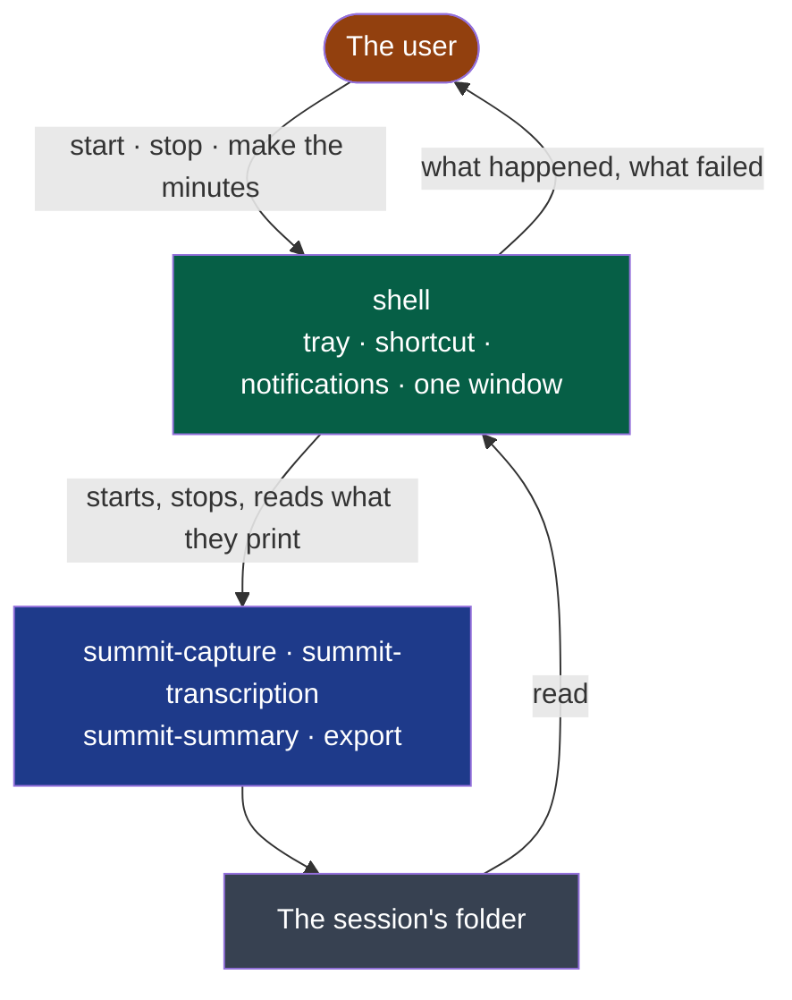

# shell

Puts Summit's four steps in the user's hands: a tray, a global shortcut, notifications, one window.

- **Owner**: NapkinStack/maintainers
- **Criticality**: standard
- **Manifest**: [MANIFEST.yaml](./MANIFEST.yaml)



**Legend** — orange: whoever uses Summit · green: this module · blue: the four steps, programs
it starts and never reads the code of · grey: files, the only thing it shares with them.

**It holds no step** (ADR-0002): closed or crashed, a recording goes on, and every step still
runs from a terminal.

**Today**: an icon in the tray whose menu starts and stops a recording, the same from a
global shortcut — Super+Alt+M under a Linux desktop — and a notification for what matters:
the reminder to announce the recording, with the microphone recorded named in it — one
other than the call's shows at once — a source that is silent, the stop, a failure. In
French where the system is, in English anywhere else.

**The window** (cycle 03, from D11's drawings) is opened by *Open Summit* in the menu — or at
once by `summit --window` — and never without a gesture: the meetings in the sessions'
folder by week, newest first, each with its day, its length, what it holds and what its
audio weighs, and above them what all the audio weighs against the transcripts and minutes.
A session being recorded, or one left without its end, says so. It reads `session.json` of
both forms (`contracts/session-audio`) and writes nothing; it speaks the system's language,
follows its light or dark theme and font, in the colours of D11's boards, and reads the
folder again whenever it comes forward. A meeting opens from the list: its minutes as written, with
who wrote them and where; its transcript in the meeting's order, each line with its side and
voice, searched over what was said; who spoke over the meeting; its folder, opened in the
system's file manager. *Réglages* sets what follows a recording, the transcription's model among
those on this computer, the reminder and how long the audio is kept — each choice saved at once
in the settings file; one Summit could not read is said, and not written over. Audio kept
longer than the settings say goes to the system's trash — at start, then every hour, said once —
from sessions whose transcript is whole; their transcript and minutes stay.

**The transcript follows the stop.** Once a recording is stopped, its transcript is made
without another gesture, on this machine, with the model the settings name; a notification
says when it is there, and a click on it opens the session's folder under a Linux desktop.
A transcript that failed is said in one sentence, the recording untouched: *Transcribe the
last recording*, in the menu, makes it again from where it stopped; it is greyed while a
recording runs, whose transcript follows its stop. One transcript at a time: a stop during
another waits for it. Quitting Summit ends a transcript being made; it goes on the same way. **The model, on the user's word.** The first transcript needs the Whisper model. Summit says
so, and puts one entry in its menu: *Download the model (874 MB, huggingface.co)*. Nothing is
fetched before it is chosen. The model comes into a part file beside its place. A cut is
taken up where it stopped, and the model is used only whole and with the SHA-256 its authors
publish. Then the waiting transcript is made. A model the settings name, and which is not
there, is said with where it was looked for: it is the user's own, never fetched.

```bash
nstack bootstrap shell && nstack bootstrap capture
(cd modules/capture && cargo build --locked --release)
(cd modules/transcription && cargo build --locked --release)
SUMMIT_CAPTURE=$PWD/modules/capture/target/release/summit-capture \
  SUMMIT_TRANSCRIPTION=$PWD/modules/transcription/target/release/summit-transcription nstack run shell
```

| On a Linux desktop | What it takes |
|---|---|
| The icon | Under GNOME, an extension that shows tray icons — *AppIndicator and KStatusNotifierItem Support*. Without it Summit runs, unseen |
| The shortcut | The desktop grants it to an application it can find: a desktop entry of Summit's name in the user's `applications` folder, **whose `Exec` line is the program's whole path** — the desktop reads no entry whose program it cannot find, and says so as "App info not found". The line under the table installs it. Then start Summit again and accept the desktop's question. Refused, Summit says so once; the menu still does the same |

```bash
sed "s#^Exec=.*#Exec=$PWD/modules/shell/target/release/summit#" modules/shell/linux/dev.summit.Summit.desktop \
  > "${XDG_DATA_HOME:-$HOME/.local/share}/applications/dev.summit.Summit.desktop"
```

**Settings** — `summit/settings.toml` in the user's configuration folder, a few lines a person
reads and writes without Summit: `reminder = false` to stop the reminder; `sessions = "…"` for
where sessions go; `after = "nothing"`, `"transcript"` or `"minutes"` for what follows a
recording (`transcript = false`, from before, still means nothing); `model = "…"` for the
Whisper model; `minutes_provider` — `"ollama"`, or a provider's address — and `minutes_model`
for who writes the minutes; `keep_audio = "always"` or a number of days. Out of the box,
sessions go to a folder `Summit` in the user's documents, the transcript follows alone, and the
model is `summit/models/ggml-large-v3-turbo-q8_0.bin` in the user's data folder — fetched there
on the user's word, or placed by hand. When Summit writes the file it touches only what changed:
a line it changes keeps its comment, and every other line, comment and key stays as written; a
file it cannot read as settings it never writes over.

## Getting started

The standard verbs — `bootstrap`, `check`, `test`, `run` — are declared in the `commands`
section of the [manifest](./MANIFEST.yaml), for this module's stack. What each one must do:
`.nstack/handbook/09-platform.md` §2.

`e2e` drives Summit on the desktop: the tray's menu over the session bus, then the window over
WebDriver — WebKitGTK's own (`WebKitWebDriver`, in Fedora's `webkit2gtk4.1-devel`) behind
`tauri-driver`, which the script installs when it is missing (`scripts/e2e_window.py`).

## Contracts

- Provided: none
- Consumed: [`recording/v1`](../../contracts/recording/v1/README.md) — what `summit-capture` says while it records
  (`src/recording.rs`); [`transcript/v1`](../../contracts/transcript/v1/README.md) — only that a session's
  `transcript.jsonl` is there once `summit-transcription` ended well (`src/transcription.rs`);
  [`session-audio`](../../contracts/session-audio/v2/README.md), v1 and v2 — a session's `session.json`, for the
  window's list (`src/sessions.rs`); the transcript's segments and [`minutes/v1`](../../contracts/minutes/v1/README.md)
  — one meeting's, as the window will open it (`src/meeting.rs`, `src/minutes.rs`). The contracts of the files it will read are declared with the slice that reads
  them

## Decisions

[ADR-0002](../../docs/adr/0002-a-rust-core-of-programs-and-a-web-view-shell.md).
