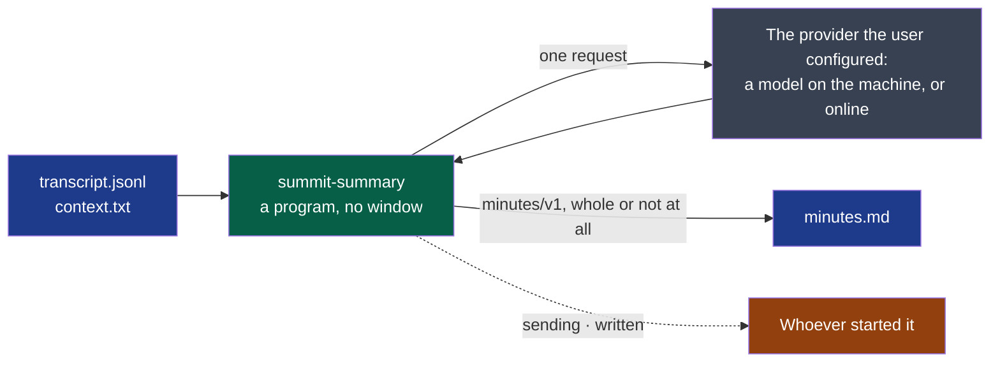

# summary

Writes the minutes of a transcript.

- **Owner**: NapkinStack/maintainers
- **Criticality**: standard
- **Manifest**: [MANIFEST.yaml](./MANIFEST.yaml)



**Legend** — blue: files of the session's folder · green: this module · grey: the only host
it contacts · orange: who reads its events, one JSON object per line.

```bash
summit-summary <session-folder> --provider http://localhost:11434/v1 --model <name>
```

A key, when the provider wants one, is read from `SUMMIT_PROVIDER_KEY` and written nowhere.
Whatever fails — no network, a refused key, an unknown model, an answer cut short or that is
not minutes — the reason is one sentence on the error stream, the transcript is untouched and
the minutes that were there are still there.

## Getting started

The standard verbs — `bootstrap`, `check`, `test`, `run` — are declared in the `commands`
section of the [manifest](./MANIFEST.yaml), for this module's stack. What each one must do:
`.nstack/handbook/09-platform.md` §2.

## Contracts

- Provided: [`minutes/v1`](../../contracts/minutes/v1/README.md), `experimental`
- Consumed: [`transcript/v1`](../../contracts/transcript/v1/README.md)

## Decisions

See `docs/adr/`.
