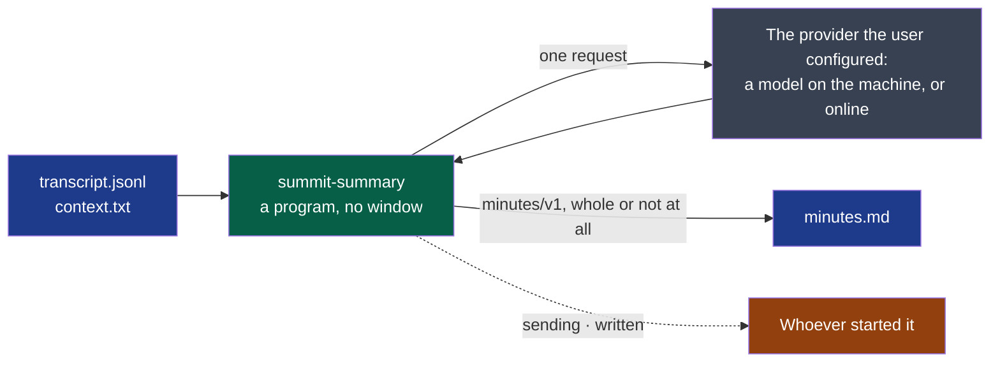

# summary

Writes the minutes of a transcript.

- **Owner**: NapkinStack/maintainers
- **Criticality**: standard
- **Manifest**: [MANIFEST.yaml](./MANIFEST.yaml)



**Legend** — blue: files of the session's folder · green: this module · grey: the only host
it contacts · orange: who reads its events, one JSON object per line.

```bash
# The example: an online provider and a large model — the one that kept every action of the
# meeting it was tried on (cycle 01, D5). The key is read from the environment, written nowhere.
summit-summary <session-folder> --provider https://openrouter.ai/api/v1 --model anthropic/claude-sonnet-5.5

# A model on the machine: nothing leaves it, no key — and, on a laptop, fewer of the actions.
summit-summary <session-folder> --provider http://localhost:11434/v1 --model mistral
```

| Tried on one meeting, with its context | Of seven actions agreed: missing | Time |
|---|---|---|
| The large model of the example | 0 | 15 s |
| A fast online model | 2 to 3 | 3 s |
| A 7B model on a laptop's processor | 4 | minutes |

**Attach a context** — `context.txt` in the session's folder, a few lines: who was there, who
is only talked about. Without it, a person the meeting talks about was written as the owner
of an action.

A key, when the provider wants one, is read from `SUMMIT_PROVIDER_KEY` and written nowhere.
Whatever fails — no network, a refused key, an unknown model, an answer cut short or that is
not minutes — the reason is one sentence on the error stream, the transcript is untouched and
the minutes that were there are still there.

## Getting started

The standard verbs — `bootstrap`, `check`, `test`, `run` — are declared in the `commands`
section of the [manifest](./MANIFEST.yaml), for this module's stack. What each one must do:
`.nstack/handbook/09-platform.md` §2.

## Contracts

- Provided: [`minutes/v1`](../../contracts/minutes/v1/README.md), `experimental`
- Consumed: [`transcript/v1`](../../contracts/transcript/v1/README.md)

## Decisions

See `docs/adr/`.
