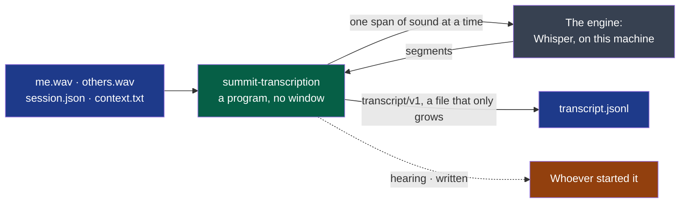

# transcription

Turns the audio of a session into a timestamped transcript.

- **Owner**: NapkinStack/maintainers
- **Criticality**: standard
- **Manifest**: [MANIFEST.yaml](./MANIFEST.yaml)



**Legend** — blue: files of the session's folder · green: this module · grey: what hears,
behind one interface (ADR-0003) · orange: who reads its events, one JSON object per line.
Nothing leaves the machine: the program contacts no host.

```bash
# The model is a Whisper model in whisper.cpp's format, already on the machine: nothing is fetched.
summit-transcription <session-folder> --model ggml-large-v3-turbo-q8_0.bin --language fr
```

| Tried on a public meeting of five minutes, four speakers, in French | Words that differ from a person's transcript | Time |
|---|---|---|
| Built with `--features vulkan`, on a laptop's graphics card | 26.8 % | 38 s |
| Built without, on its processor | 27 to 28 % | about four minutes |

**Stopped at any moment, it is run again** and goes on from where it was: what the transcript
covers is not heard twice. A recording still going on is heard up to here; its transcript
gets its last line once the session's record says `stopped`.

**Attach a context** — `context.txt` in the session's folder: names and words of the trade
the engine would otherwise write as it hears them.

Whatever is wrong — a folder that is not a session, an audio file that is not what
`session-audio/v1` describes, a model that cannot be loaded — is one sentence on the error
stream, and no transcript is created or changed.

## Getting started

The standard verbs — `bootstrap`, `check`, `test`, `run` — are declared in the `commands`
section of the [manifest](./MANIFEST.yaml), for this module's stack. What each one must do:
`.nstack/handbook/09-platform.md` §2.

## Contracts

- Provided: [`transcript/v1`](../../contracts/transcript/v1/README.md), `experimental`
- Consumed: [`session-audio/v1`](../../contracts/session-audio/v1/README.md)

## Decisions

See `docs/adr/`.
