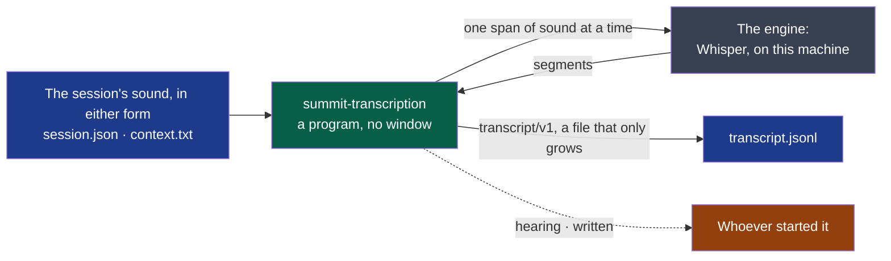

# transcription

Turns the audio of a session into a timestamped transcript.

- **Owner**: NapkinStack/maintainers
- **Criticality**: standard
- **Manifest**: [MANIFEST.yaml](./MANIFEST.yaml)



**Legend** — blue: files of the session's folder · green: this module · grey: what hears,
behind one interface (ADR-0003) · orange: who reads its events, one JSON object per line.
Nothing leaves the machine: the program contacts no host.

```bash
# The model is a Whisper model in whisper.cpp's format, already on the machine: nothing is fetched.
summit-transcription <session-folder> --model ggml-large-v3-turbo-q8_0.bin --language fr
```

| Tried on a public meeting of five minutes, four speakers, in French | Words that differ from a person's transcript | Time |
|---|---|---|
| Built with `--features vulkan`, on a laptop's graphics card | 26.8 % | 34 to 38 s |
| Built without, on its processor | 26.0 % | 230 s |

**Stopped at any moment, it is run again** and goes on from where it was: what the transcript
covers is not heard twice. A recording still going on is heard up to here; its transcript
gets its last line once the session's record says `stopped`.

**On loudspeakers, the echo is taken out** of what the engine hears of the microphone — never
out of the recording. WebRTC's canceller, fed what the loudspeakers played, takes the remote
voices out of the local track; it is used only where it measures an echo — 3 dB taken out at
least — so that a headset's microphone goes to the engine as recorded. On the bench, the
remote words written a second time under the local side fall from about 210 to none
(cycle 02, D10).

**What the engine heard is kept**, in `derived/` in the session's folder: `local.wav` and
`remote.wav`, one channel, 16,000 samples a second, the samples it was given, to the bit; and
`made.json`, what made them — the files they come from, whether an echo was taken out, how
much was measured. They weigh about 230 MB an hour of meeting each, and may be deleted: the
next run makes them again, the same to the byte, and the transcript with them. A transcript
begun while the meeting was recorded keeps the decision taken then — echo or not — for the
rest: its beginning was heard so. Delete `made.json` with it, or not at all.

**A turn starts where it was said.** Each word is timed by the model's alignment heads, and a
segment is cut where the words stop for more than 0.8 s: on the bench, at most two
exchanges in forty-four are out of order, against one in four with the engine's own segments
(cycle 02, D10). A model whose heads whisper.cpp does not hold — or the first two versions
of `large`, which one header cannot tell apart — keeps the engine's segments, and `hearing`
says so: `"times": "segments"` instead of `"words"`.

**A turn the engine jumped over is heard again.** Whisper sometimes goes from one sentence
to a later one over a whole turn whose sound is intact. Where a span holds a voice at the
level of the words the engine wrote there, for a second and a half with no word written,
that stretch is heard again alone; where it wrote nothing, nothing is. A stray word it
wrote alone in such a turn is heard again with the turn, in place of where it stood. On
the bench, the local words wrong fall from 57.5 to 41 on loudspeakers and from 41.5 to 27
with a headset, a median of four draws, and no local turn is lost with a headset. Heard alone,
Whisper may jump once more from where the stretch starts: what it leaves there is heard
again, twice deep. With a television in the room and at a quiet level, nothing is heard
again and the transcript is the same; on the trial meeting a stray word of a remote turn
becomes the turn (cycle 02, D10).

**A loop is heard again.** Whisper hears each thirty seconds of a span after the text of the
thirty before; where a track falls silent, it may write that text again and again and lose what
follows. Where a run of four words is written three times or more in what a span gave, with the
pieces of its words cut beside it, the stretch from the segment before to the segment after is
heard again alone, after no text of the window before — the context, if any, still before it —
and what it gives as marks alone (`...`) is not written. A loop is heard again first; what the
engine left unwritten is then heard again as before, where it still is. On the bench, the two
draws in eight whose remote track looped fall from 113 and 139 remote words wrong to 22 and 21;
every other draw, the television and the trial meeting are unchanged (cycle 02, D10).

**What the engine writes on silence is not kept.** Whisper writes text where nobody speaks: a
sentence of the meeting again and again, a word of another language, a credit line. Each side
is heard on its own track, and a track is silent while the other side speaks. A segment
written where its own track sounds more than 34 dB under that track's speech level is
dropped. The level is read from the tenths of a second that sound, so a side that speaks
little is measured on its voice. The engine hears exactly what it heard before.
- **A real call** (a headset, a TV in the room): every invented segment lay 38.5 dB or more
  under its track's level, and the quietest said one 28.2 dB under it. All the invented ones
  left.
- **The bench:** 11 transcripts of 13 unchanged, the two others losing one invented line
  each.
- **The trial meeting:** unchanged (cycle 02, D10).

**Attach a context** — `context.txt` in the session's folder: names and words of the trade
the engine would otherwise write as it hears them.

Whatever is wrong — a folder that is not a session, an audio file that is not what
`session-audio/v1` or `v2` describes, a language the engine does not know, a model that cannot be
loaded — is one sentence on the error stream, before anything is said to be heard, and no
transcript is created or changed. What only shows once the model is there — a transcript
another language or model made, a folder that cannot be written to — is said after `hearing`. Leave `--language` out to have the language detected.

## Getting started

The standard verbs — `bootstrap`, `check`, `test`, `run` — are declared in the `commands`
section of the [manifest](./MANIFEST.yaml), for this module's stack. What each one must do:
`.nstack/handbook/09-platform.md` §2.

## Contracts

- Provided: [`transcript/v1`](../../contracts/transcript/v1/README.md), `experimental`
- Consumed: [`session-audio/v1`](../../contracts/session-audio/v1/README.md) and
  [`session-audio/v2`](../../contracts/session-audio/v2/README.md) — `session.json` names
  which, and `hearing` says which was read (`audio`)

## Decisions

[ADR-0003](../../docs/adr/0003-transcribe-behind-one-interface-whisper-on-the-graphics-card.md):
one interface, Whisper on the graphics card.
[ADR-0004](../../docs/adr/0004-the-audio-as-recorded-is-kept-everything-else-is-derived.md):
the tracks are the recording; what an engine hears is made from them, and kept apart.
